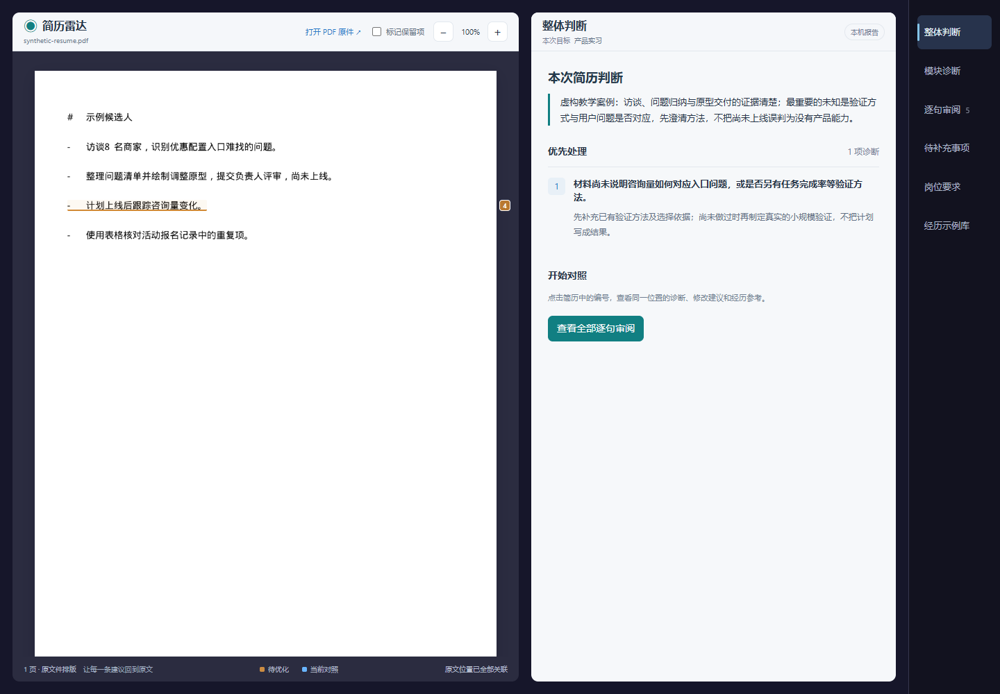

# 简历雷达 · Resume Radar

从岗位发现、简历诊断、能力差距分析到简历优化的求职工作流 Agent。由 Codex 执行分析，在本机网页中对照 PDF 原件、诊断、改写和固定经历案例。

当前版本：**0.16.8**。支持多职业分析；随包固定案例覆盖产品经理细分岗位。

## 报告预览



*截图使用仓库内的虚构教学案例，不含真实求职者资料。左侧保留 PDF 原件，右侧查看诊断与建议；点击编号可对照对应原句。示例仅展示交互，不代表实际求职结果。*

## 安装

1. 从 [Releases](https://github.com/Lan-shx/resume-radar/releases/latest) 下载最新 `resume-radar-版本.zip`。
2. 解压，将 `resume-radar` 文件夹放进 `~/.codex/skills/`。Windows 通常为 `C:/Users/你的用户名/.codex/skills/`。
3. 新建 Codex 聊天，引用 `$resume-radar` 并提供可选择文字的 PDF 简历，可同时提供意向岗位或 JD。

需要 Python 3.10+ 和 PyMuPDF。缺少依赖时由 Codex 按安装说明运行 `python -m pip install -r <安装目录>/requirements.txt`。网页无需 Chrome 扩展、模型 Key 或在线服务；当前不支持扫描件 OCR 和 Word 自动转换。

## 使用流程

用户只做一次“本次求职目标”选择，同时确定方向、JD 来源和目标岗位：

- **不明确，帮我推荐**：根据简历检索真实 JD，由 Agent 推荐主目标并继续。
- **已有岗位或 JD**：使用用户指定或选定的对象分析。
- **通用简历诊断**：不针对具体 JD，分析经历结构、项目价值和表达。

已有明确指令直接沿用。默认检查全份简历、逐句审阅并生成忠实优化全文，不另设输出方案或事实补充关卡。未知事实直接标注，不编造数字、贡献或效果。局部润色和单独面试训练按原请求处理。

分析与校验完成后打开报告，支持：

- PDF 原件与诊断双向定位，小编号位于原件右侧；项目符号不单独计为问题。
- 整体判断、模块诊断、逐句审阅、待补充事项、岗位要求及优化全文；通用诊断隐藏岗位要求。
- 模块诊断与逐句审阅按教育、实习、项目等实际章节筛选。
- 固定经历库检索、查看与复制；处理标记保存在当前浏览器，不改写原 PDF。

## 固定案例与事实边界

保留四个核心模块的方法：统一入口、岗位分析、简历优化、证据追问与面试训练。完整任务默认不主动追问，面试训练由用户单独请求。

Hired 固定库包含 41 类产品经理岗位、351 个方向、2,125 组教学案例，保留原文与来源说明。案例包含虚构情节和结果数字，不能作为候选人的事实证据；不使用 AI 生成新案例补库。非产品经理目标不强配产品经理案例。

## 个人资料与发布边界

个人简历、分析、回答和报告保存在用户指定的本机运行目录。源码与安装包不收录个人使用记录或登录凭据；不提供带个人资料的页面截图。合成测试样例明确标注，不代表实际候选人。

本机网页不主动调用模型；Codex 推理及岗位检索遵循当前宿主环境的数据处理设置。详细边界见 [PRIVACY.md](PRIVACY.md)，来源说明见 [THIRD_PARTY_NOTICES.md](THIRD_PARTY_NOTICES.md)。

## 项目结构

| 目录 | 内容 |
| --- | --- |
| `skills/` | 四个核心模块及工作流说明 |
| `scripts/` | 来源管理、确认、校验、PDF 定位、报告与打包 |
| `assets/` | 网页模板和固定案例资源 |
| `standards/` | 数据契约与判断标准 |
| `evals/` | 合成测试与行为验证 |

## 开发与打包

```text
python evals/run_eval.py
python scripts/package_skill.py --output <发布目录>/resume-radar-0.16.8.zip
```

完整任务见 [工作流说明](skills/resume-radar/references/guided-workflow.md)，原件对照见 [工作台说明](skills/resume-radar/references/workbench.md)，版本变化见 [CHANGELOG.md](CHANGELOG.md)。

安装包按程序资源清单生成，只保留一个“简历雷达”主入口与三个专业模块。初始化与渲染均不代替实际分析；通过机械校验不代表事实已获外部证明或预测录用结果。
